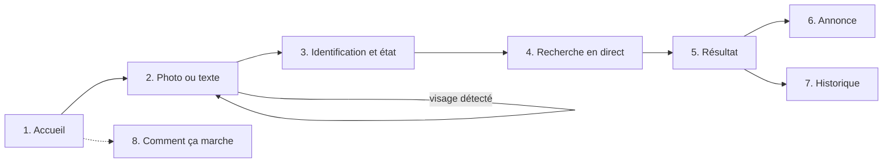

# Snap N Cash : parcours utilisateur et écrans v0

16/11/2026 · Tristan (CPO)

## En bref

Le parcours tient en 7 écrans, de la photo à l'annonce copiée, plus la page « Comment ça marche ». Chaque écran ci-dessous a son contenu, ses états et un prompt v0 prêt à coller.

Tout vient de Specs.md (points 1 à 10), de CLAUDE.md (règles non négociables) et des tests d'agents du JOURNAL du 16/11. Rien n'a été généré dans v0 ni testé : ce sont des maquettes à produire.

**Pour demain :** montrer le schéma du parcours, puis les écrans 4 et 5 (recherche en direct et résultat), qui portent la démo. Les questions de la dernière section sont à trancher avec Jude avant de coder.

**Mode d'emploi v0 (budget 30 $) :** un seul projet v0. Coller d'abord le prompt de base, puis un prompt par écran dans la même conversation, pour garder la charte et les types de données.

## Parcours utilisateur

L'utilisateur va de la photo à l'annonce copiée en 6 écrans, sans compte. L'écran 4, où les agents H naviguent sous ses yeux, est le cœur de la démo.



Une photo avec un visage renvoie à l'écran 2 ; le texte libre passe directement à l'identification. Si aucune boutique n'a l'objet (Redmi Note 10S en démo), l'écran 5 montre le seul bloc eBay.

1. **Accueil :** l'utilisateur choisit photo ou texte libre.
2. **Photo ou texte :** consigne « objet seul », contrôle du visage, secours par le texte.
3. **Identification et état :** il confirme marque, modèle et version, puis répond à l'état, la boîte et les accessoires.
4. **Recherche en direct :** eBay et les 4 boutiques répondent chacun à leur rythme, 90 s maximum par site.
5. **Résultat :** « Vendre seul (eBay) » avec le prix conseillé, « Revendre en magasin » avec l'estimation basse, détail par site et boutons vers Vinted, Leboncoin, Cdiscount et TikTok Shop.
6. **Annonce :** 4 formats à copier, publiés par l'utilisateur lui-même.
7. **Historique :** les estimations passées, gardées dans le navigateur.
8. **Comment ça marche :** sites consultés, calcul, IA, données.

## Charte commune et prompt de base v0

Le prompt de base fixe la charte, la mise en page et le format des données que le serveur FastAPI enverra site par site. Le coller en premier, une seule fois.

| Élément | Choix proposé | Pourquoi |
| --- | --- | --- |
| Cible | 18-35 ans, sur mobile d'abord | Specs : site adapté au mobile et à l'ordinateur |
| Ton | Tutoiement, phrases courtes | Public jeune, démo rapide |
| Couleurs | Fond clair, une couleur d'accent (vert « cash ») | Lisible en démo sur vidéoprojecteur |
| Bloc eBay | Bordure et titre propres, jamais dans la même liste que les boutiques | Règle 4 de CLAUDE.md, licence eBay |
| Mentions | Bandeau « estimation et annonce générées par IA » + « prix indicatifs » sur les écrans 5 et 6, pied de page sur tous | Specs point 10, AI Act art. 50 |
| Données | Données fictives dans la maquette, types prêts pour le flux du serveur | Jude branchera le vrai flux |

```text
Crée une application web Next.js (App Router, TypeScript, Tailwind, shadcn/ui) nommée « Snap N Cash », en français, conçue mobile d'abord et qui s'adapte à l'ordinateur.

Concept : l'utilisateur photographie un objet high-tech ou un jeu vidéo. Un modèle IA l'identifie, des agents IA relèvent les prix sur des boutiques d'occasion, une API eBay donne les prix des particuliers. L'app affiche deux prix séparés (vendre seul sur eBay, revendre en magasin) et une annonce prête à copier.
Slogan : « Ce qui dort chez vous a un prix. »

Charte :
- Fond clair, texte quasi noir, une seule couleur d'accent verte pour les prix et le bouton principal. Coins arrondis, cartes avec ombre légère, police sans serif.
- Tutoiement, phrases courtes.
- Un en-tête avec le logo texte « Snap N Cash », un lien « Historique » et un lien « Comment ça marche ».
- Un pied de page sur toutes les pages : « Prix indicatifs. Estimation et annonce générées par IA. Comparaison non exhaustive : voir Comment ça marche. »
- N'écris jamais « tous les sites » ni « meilleur prix garanti ».

Pages à prévoir (je te les donnerai une par une) : accueil, photo, identification, recherche en direct, résultat, annonce, historique, comment ça marche.

Données : utilise des données fictives dans un fichier lib/mock.ts, avec ces types TypeScript dans lib/types.ts :

type StatutSite = 'en_attente' | 'en_cours' | 'ok' | 'aucun_resultat' | 'indisponible';
type Offre = { titre: string; prix: number; etat?: string; lien: string };
type ResultatSite = {
  site: 'ebay' | 'easycash' | 'gamecash' | 'troc' | 'cashconverters';
  nom: string;
  type: 'particuliers' | 'boutique';
  statut: StatutSite;
  etapes: string[];        // ex. « ouvre Easy Cash », « catégorie Consoles », « 6 prix trouvés »
  offres: Offre[];
  urlAgentDirect?: string; // lien vers la vue de l'agent H (direct ou replay), absent pour eBay
  dureeSecondes?: number;
};
type Objet = { marque: string; modele: string; etat: 'Comme neuf' | 'Très bon' | 'Bon' | 'Correct'; boite: boolean; accessoires: string[]; variante?: string };
type Estimation = {
  id: string; date: string; objet: Objet;
  vendreSeul?: { bas: number; haut: number; prixConseille: number };   // eBay seul
  enMagasin?: { bas: number; haut: number; estimationBasse: number };  // boutiques seules
  sites: ResultatSite[];
};

Objet de démo : Nintendo Switch. Les prix de la maquette sont fictifs.
Pour l'instant, crée seulement la mise en page commune (en-tête, pied de page), les types et les données fictives, et une page d'accueil vide.
```

## Écrans un par un

### Écran 1 : Accueil

**But :** faire démarrer en un geste. **Specs :** point 1, point 9, usage anonyme.

- Slogan, une phrase d'explication, gros bouton « Prendre une photo ».
- Lien secondaire « Taper le nom de l'objet » (texte libre).
- Rappel « High-tech et jeux vidéo » et « Gratuit, sans compte ».
- Les 3 dernières estimations si l'historique local n'est pas vide.

```text
Crée la page d'accueil (app/page.tsx).
- En haut : le slogan « Ce qui dort chez vous a un prix. » et la phrase « Une photo, le bon prix, l'annonce prête. »
- Un grand bouton vert « Prendre une photo » qui mène à /photo.
- Dessous, un lien texte « Pas de photo ? Tape le nom de l'objet » qui mène à /photo?mode=texte.
- Trois pastilles : « High-tech et jeux vidéo », « Gratuit, sans compte », « Résultat en moins de 2 min ».
- Une section « Tes dernières estimations » qui lit localStorage (clé snapncash_historique, tableau d'Estimation) et affiche les 3 plus récentes en cartes (objet, date, prix conseillé). Masque la section si l'historique est vide.
- Une section « Comment ça marche » en 3 étapes illustrées par des icônes : 1. Tu photographies l'objet. 2. Nos agents comparent les prix sur des sites d'occasion. 3. Tu choisis : vendre seul ou en magasin, et tu copies l'annonce. Lien « En savoir plus » vers /comment-ca-marche.
```

### Écran 2 : Photo ou texte

**But :** une photo exploitable, sans personne dessus. **Specs :** points 1 et 2, règle 6.

- Consigne visible au moment de la prise de vue : « Photo de l'objet seul, sans visage ».
- Caméra du téléphone ou import d'un fichier sur ordinateur.
- Onglet « Texte libre », qui sert aussi de secours si la photo échoue.
- **État refusé :** un visage est détecté, la photo est refusée et l'utilisateur la reprend.
- **État échec :** l'objet n'est pas reconnu, on propose le texte libre.

```text
Crée la page /photo avec deux onglets : « Photo » et « Texte libre » (onglet ouvert par défaut selon ?mode=texte).

Onglet Photo :
- Un encadré bien visible au-dessus de la zone de prise de vue : icône appareil photo et le texte « Photographie l'objet seul, sans visage ni personne. Fond uni et bonne lumière. »
- Un input fichier avec accept="image/*" et capture="environment" (caméra arrière sur mobile, import sur ordinateur), aperçu de la photo, boutons « Reprendre » et « Analyser ».
- Pendant l'analyse : un loader « Vérification de la photo… » puis « Identification de l'objet… ».
- État refusé (simulé par un bouton de démo) : alerte rouge « On a détecté un visage sur la photo. Pour ta vie privée, on ne l'analyse pas. Reprends une photo de l'objet seul. » La photo est retirée de l'aperçu.
- État non reconnu : « On n'a pas reconnu l'objet. » avec un bouton « Taper le nom » qui ouvre l'onglet Texte libre.
- Petite mention sous la zone : « Ta photo sert seulement à l'analyse. Elle n'est pas conservée. »

Onglet Texte libre :
- Un champ « Quel objet veux-tu vendre ? » avec l'exemple « Nintendo Switch OLED blanche », et un bouton « Continuer ».

Les deux chemins mènent à /identification avec l'objet fictif du mock.
```

### Écran 3 : Identification et état

**But :** confirmer l'objet et préciser son état avant de lancer les agents. **Specs :** points 1 et 3. Le JOURNAL montre que les variantes mélangées faussent les prix (iPhone 12 en 64 et 128 Go, Switch et Switch OLED) : on demande la variante ici.

- Marque et modèle proposés par le modèle vision, modifiables.
- Variante (capacité, édition) quand elle change le prix.
- État, boîte, accessoires : réponses en un tap.
- Bouton « Lancer la recherche des prix ».

```text
Crée la page /identification.
- En haut : la vignette de la photo (si elle existe) et « On pense que c'est : » suivi de la marque et du modèle en gros (mock : Nintendo Switch). Un bouton « Corriger » rend les deux champs modifiables.
- Un badge discret « Identifié par IA ».
- « Quelle version ? » : boutons segmentés (mock : Switch, Switch OLED, Switch Lite). Pour un téléphone, ce seraient les capacités (64 Go, 128 Go, 256 Go).
- « Dans quel état ? » : 4 cartes sélectionnables avec une ligne d'aide chacune : Comme neuf (aucune trace), Très bon (traces légères), Bon (rayures visibles), Correct (défauts, fonctionne).
- « Tu as encore la boîte ? » : Oui / Non.
- « Accessoires inclus » : cases à cocher (mock : Joy-Con, station d'accueil, chargeur, câble HDMI).
- Bouton principal « Lancer la recherche des prix », désactivé tant que l'état n'est pas choisi, qui mène à /recherche.
```

### Écran 4 : Recherche en direct

**But :** montrer les agents au travail, site par site. C'est l'écran le plus fort de la démo. **Specs :** points 4 et 5.

- 5 cartes : eBay en haut, séparé ; les 4 boutiques dessous (Easy Cash, Gamecash, Troc.com, Cash Converters).
- Chaque carte a son statut : en attente, en cours (avec les étapes de l'agent qui s'ajoutent), terminé avec N prix, aucun résultat, indisponible après 90 s.
- Un chronomètre par carte jusqu'à 90 s.
- Lien « Voir l'agent en direct » puis « Revoir la session » (vue Agent View de H, confirmée par les tests du 16/11). Voir la question ouverte sur la règle 9.
- Bouton « Voir le résultat » actif dès qu'eBay ou une boutique a répondu, mise en avant quand tout est fini.

```text
Crée la page /recherche qui simule un flux de résultats site par site.
- Titre : « On compare les prix pour ta Nintendo Switch » et sous-titre « Chaque site s'affiche dès qu'il répond. Environ 1 à 2 minutes. »
- Bloc 1, titré « Particuliers » : une seule carte eBay, avec le libellé « API officielle eBay ».
- Bloc 2, titré « Boutiques d'occasion », avec « Nos agents IA visitent chaque boutique » : 4 cartes Easy Cash, Gamecash, Troc.com, Cash Converters, en grille 2 colonnes sur ordinateur et 1 colonne sur mobile.
- Chaque carte boutique montre : le nom du site, un badge de statut (En attente gris, En cours bleu animé, Terminé vert avec « N prix », Aucun résultat gris, Indisponible orange), un chronomètre qui monte jusqu'à 90 s, et la liste des étapes de l'agent qui s'ajoutent une par une avec une petite animation (ex. « Ouvre Easy Cash », « Catégorie Consoles », « Page 2 », « 6 prix trouvés »).
- Sur les cartes boutique : un lien « Voir l'agent en direct » pendant la recherche, qui devient « Revoir la session » une fois terminé (ouvre urlAgentDirect dans un nouvel onglet).
- Simulation dans le mock avec des timers : eBay répond en 3 s ; Gamecash termine en 25 s avec 4 prix ; Easy Cash termine en 40 s avec 6 prix ; Cash Converters termine en 35 s avec 3 prix ; Troc.com passe en « Aucun résultat » à 20 s. Prévois aussi le cas « Indisponible » : si une carte dépasse 90 s, elle affiche « Ce site n'a pas répondu à temps. L'estimation se fait sans lui. » (simule-le avec un paramètre ?lent=troc).
- En bas, un bouton collant « Voir le résultat », actif dès qu'un site a répondu, en vert plein quand tous les sites ont un statut final. Il mène à /resultat.
- Ne montre jamais de capture d'écran des sites : seulement les étapes en texte et le lien vers la vue de l'agent.
- Isole la logique de simulation dans un hook useFluxRecherche() pour qu'on puisse le remplacer par un vrai flux EventSource (Server-Sent Events) qui envoie un ResultatSite à chaque mise à jour.
```

### Écran 5 : Résultat

**But :** répondre à « combien et où vendre ? » en un coup d'œil. **Specs :** points 6, 7 et 10, règles 4, 8 et 9.

- Deux blocs qui ne se mélangent jamais : « Vendre seul (eBay) » puis « Revendre en magasin ».
- Vendre seul : fourchette et prix conseillé, mis en avant comme prix principal.
- Revendre en magasin : fourchette et « estimation basse ».
- Dans chaque bloc, le détail par site : titre de l'offre, prix, état, lien.
- **Cas sans boutique** (Redmi Note 10S en démo) : seul le bloc eBay s'affiche, avec un message.
- Boutons « Chercher aussi sur » Vinted, Leboncoin, Cdiscount, TikTok Shop, qui ouvrent leur recherche dans le navigateur. Ces sites ne sont pas consultés par nos agents.
- Bandeau « Prix indicatifs. Estimation générée par IA. »

```text
Crée la page /resultat à partir de l'Estimation fictive du mock (Nintendo Switch).
- En haut : le nom de l'objet, sa version, son état, et un bandeau d'information « Prix indicatifs. Estimation et annonce générées par IA. » avec un lien « Comment on calcule » vers /comment-ca-marche.
- Bloc 1, carte à bordure verte épaisse, titre « Vendre seul (eBay) », sous-titre « Tu publies ton annonce et tu vends à un particulier. » : le prix conseillé en très gros (ex. 180 €) avec l'étiquette « Prix conseillé », la fourchette dessous (ex. « Entre 160 € et 210 € »), puis un accordéon « Voir les annonces eBay » avec la liste des offres eBay (titre, prix, état, lien « Voir sur eBay »).
- Bloc 2, carte séparée à bordure grise, titre « Revendre en magasin », sous-titre « Tu déposes l'objet en boutique et tu es payé tout de suite. » : « Estimation basse » en gros (ex. 95 €), la fourchette dessous, et une ligne d'aide « Calculée à partir des prix de revente en boutique. L'offre réelle se fait en magasin. ». Puis le détail par boutique : un sous-groupe par site (Easy Cash, Gamecash, Cash Converters…) avec ses offres (titre, prix, état, lien « Voir l'offre »), et les sites sans résultat ou indisponibles listés en gris avec leur statut.
- Les deux blocs ne partagent jamais une même liste ni une même moyenne : deux cartes distinctes, l'une sous l'autre sur mobile, côte à côte sur ordinateur.
- Cas sans boutique : si enMagasin est absent, remplace le bloc 2 par une carte grise « Aucune boutique n'a cet objet en vente aujourd'hui. On te conseille de vendre seul. » Ajoute un bouton de démo pour basculer sur ce cas.
- Une section « Chercher aussi sur » avec 4 boutons contour : Vinted, Leboncoin, Cdiscount, TikTok Shop. Chacun ouvre dans un nouvel onglet la page de recherche du site avec le nom de l'objet. Sous les boutons : « Ces sites ne sont pas consultés par Snap N Cash. On ouvre simplement leur recherche pour toi. » N'utilise pas leurs logos, seulement leur nom en texte.
- Bouton principal « Préparer mon annonce » vers /annonce, et bouton secondaire « Nouvelle estimation ».
- À l'affichage, enregistre l'estimation dans localStorage (clé snapncash_historique).
- Aucune capture d'écran de site : seulement prix et liens.
```

### Écran 6 : Annonce

**But :** une annonce prête à coller, sans retaper. **Specs :** point 8, règle 4.

- 4 onglets : Vinted, Leboncoin, eBay, texte générique.
- Titre, description, prix proposé, bouton « Copier » sur chaque champ et sur le tout.
- Champs modifiables avant copie.
- Mention « Annonce générée par IA, relis-la avant de publier ».
- L'utilisateur publie lui-même : aucun bouton « Publier ».

```text
Crée la page /annonce.
- Titre « Ton annonce est prête » et un bandeau « Annonce générée par IA. Relis-la et corrige-la avant de publier. »
- 4 onglets : Vinted, Leboncoin, eBay, Texte générique. Chaque onglet montre un champ Titre (avec compteur de caractères), un champ Description (zone de texte), un champ Prix proposé (prérempli avec le prix conseillé), tous modifiables.
- Le style change selon l'onglet : Vinted court et décontracté avec emojis modérés, Leboncoin descriptif et rassurant (état, remise en main propre possible), eBay factuel et structuré (caractéristiques en liste), générique neutre. Mets des textes fictifs pour la Nintendo Switch dans le mock.
- Un bouton « Copier » à côté de chaque champ et un gros bouton « Copier toute l'annonce », avec une confirmation « Copié » (toast).
- Sous l'onglet : un lien « Ouvrir [nom du site] pour publier » vers la page d'accueil du site, dans un nouvel onglet. Pour Texte générique, pas de lien.
- Pas de bouton « Publier » : l'utilisateur colle et publie lui-même.
- Lien retour « Revoir les prix » vers /resultat.
```

### Écran 7 : Historique

**But :** retrouver une estimation sans compte. **Specs :** point 9, règle 5.

```text
Crée la page /historique.
- Titre « Tes estimations » et la ligne « Enregistrées seulement sur cet appareil. Snap N Cash ne garde rien sur ses serveurs. »
- Liste lue depuis localStorage (clé snapncash_historique), la plus récente en premier : carte avec objet, version, état, date, prix conseillé (vendre seul) et estimation basse (magasin) s'ils existent. Pas de photo stockée : une icône de catégorie à la place.
- Clic sur une carte : rouvre /resultat avec cette estimation.
- Bouton « Supprimer » par carte et bouton « Tout effacer » avec une confirmation en modal shadcn (pas d'alert() du navigateur).
- État vide : « Aucune estimation pour l'instant. » et un bouton « Prendre une photo ».
```

### Écran 8 : Comment ça marche

**But :** les mentions légales lisibles, pas un bloc juridique. **Specs :** point 10, règle 8 (article L111-7 du Code de la consommation, AI Act article 50).

- Les 3 étapes du service.
- La liste nominative des sites consultés et la façon de les consulter.
- « Comparaison non exhaustive », dit clairement.
- Le critère de classement des offres (à confirmer, voir les questions ouvertes).
- Comment sont calculés les deux prix, sans chiffre de décote figé tant qu'il n'est pas mesuré.
- Ce que fait l'IA, ce qu'on garde (rien côté serveur), le refus des photos avec visage.

```text
Crée la page /comment-ca-marche, en sections claires avec titres et icônes, sans jargon.

1. « En 3 étapes » : tu photographies l'objet ; une IA l'identifie et nos agents relèvent les prix sur des sites d'occasion ; tu choisis entre vendre seul et revendre en magasin, puis tu copies l'annonce.

2. « Les sites que nous consultons » : un tableau avec 3 colonnes (Site, Ce qu'on y regarde, Comment) :
- eBay : annonces de particuliers ; API officielle eBay.
- Easy Cash : prix de revente en boutique ; agent IA qui navigue par les pages de catégorie.
- Gamecash : prix de revente en boutique ; agent IA.
- Troc.com : prix de revente en boutique ; agent IA.
- Cash Converters : prix de revente en boutique ; agent IA.
Sous le tableau, en gras : « Cette comparaison n'est pas exhaustive. D'autres sites et magasins existent et peuvent proposer d'autres prix. »
Puis : « Les boutons Vinted, Leboncoin, Cdiscount et TikTok Shop ouvrent simplement leur recherche dans ton navigateur. Nous ne consultons pas ces sites. »

3. « Comment les offres sont classées » : « Dans chaque bloc, les offres sont classées par site, puis par prix croissant. Aucun site ne paie pour apparaître ou être mieux placé. »

4. « Comment on calcule les deux prix » :
- Vendre seul : à partir des annonces eBay seules. On retire les prix aberrants, on garde la fourchette, puis on applique une petite décote à la médiane pour vendre plus vite. C'est notre prix conseillé.
- Revendre en magasin : à partir des prix de revente des boutiques seules. Une boutique rachète moins cher qu'elle ne revend : on applique un coefficient et on affiche une estimation basse. L'offre réelle se fait en magasin.
- Les deux calculs restent séparés : on ne mélange jamais les prix eBay et ceux des boutiques.
- Tous les prix sont indicatifs.

5. « Ce que fait l'IA » : « L'identification de l'objet, la navigation des agents et l'annonce sont générées par IA. Elles peuvent contenir des erreurs : vérifie avant de publier. »

6. « Tes données » : pas de compte ; ta photo sert seulement à l'analyse et n'est pas conservée ; une photo où un visage est détecté est refusée ; ton historique reste dans ton navigateur ; nos serveurs ne gardent ni photo, ni annonce relevée, ni nom de vendeur.

7. « Limites » : high-tech et jeux vidéo seulement ; un site peut ne pas répondre à temps (90 s) et l'estimation se fait alors sans lui ; les stocks d'occasion changent chaque jour.
```

## Mentions obligatoires et règles respectées

Chaque règle de CLAUDE.md et chaque mention du point 10 des Specs a sa place dans un écran. Ce tableau sert de liste de contrôle une fois les écrans générés dans v0.

| Règle ou mention | Où dans l'interface |
| --- | --- |
| Prix indicatifs (Specs 10, règle 8) | Bandeau des écrans 5 et 6, pied de page, section 4 de l'écran 8 |
| « Estimation et annonce générées par IA » (AI Act art. 50) | Bandeau des écrans 5 et 6, badge de l'écran 3, pied de page, section 5 de l'écran 8 |
| Liste des sites consultés, non exhaustive, critère de classement (L111-7) | Écran 8, sections 2 et 3 |
| Jamais « tous les sites » | Interdit dans le prompt de base ; à rechercher dans le code généré |
| eBay séparé des boutiques (règle 4) | Blocs distincts aux écrans 4 et 5, calcul séparé décrit à l'écran 8 |
| Refus des photos avec visage (règle 6) | Consigne et état refusé de l'écran 2 |
| Rien gardé côté serveur, historique local (règle 5) | Écrans 2, 7 et section 6 de l'écran 8 |
| Pas de capture des sites sources (règle 9) | Écrans 4 et 5 : prix, étapes en texte et liens seulement |
| Pas d'agent sur Vinted, Leboncoin, Cdiscount, TikTok Shop (règle 1) | Simples boutons de recherche à l'écran 5, avec la mention « non consultés » |

**Après génération dans v0, vérifier aussi :** pas de logo des sites tiers (seulement leur nom), pas de `alert()` du navigateur, aucun texte promettant un « meilleur prix ».

## Questions ouvertes pour l'équipe

Cinq points touchent les Specs ou les règles : CLAUDE.md demande de s'arrêter et de demander en cas de doute. Ils sont à trancher avec Jude avant de brancher les écrans.

- [ ] **Vue de l'agent en direct et règle 9.** Les Specs (point 5) veulent montrer les agents qui naviguent, mais la règle 9 interdit de montrer une capture des pages sources. La vue Agent View de H affiche ces pages. Proposition : un simple lien vers la vue H dans un nouvel onglet, ou seulement les étapes en texte si l'équipe juge le lien trop proche d'une capture.
- [ ] **Prix dans l'annonce.** Les données eBay ne doivent pas passer dans le modèle de texte, or le prix conseillé vient d'eBay. Proposition : le modèle rédige titre et description sans prix, et notre code ajoute le prix ensuite.
- [ ] **Critère de classement (L111-7).** À valider : « par site, puis par prix croissant, aucun site ne paie ».
- [ ] **Variante de l'objet.** Ajouter la question « Quelle version ? » (capacité, édition) à l'écran 3, comme le suggèrent les tests iPhone 12 et Switch OLED du JOURNAL. Elle n'est pas dans les Specs.
- [ ] **Temps d'attente affiché.** Les tests du 16/11 montrent 60 à 85 s par boutique, jusqu'à 167 s sans réponse forcée. L'écran 4 annonce « 1 à 2 minutes » : à ajuster après les tests de mardi.

**Pas couvert ici :** le sondage maison (action 5 des Specs), voir [sondage_maison.md](../sondage/sondage_maison.md).
